<div align="center">

# 🐾 PetDesktop

### 让生活中的每一个瞬间，都有一只小猫陪伴。

一款融合 AI 对话、日记、日历与任务管理的桌面生活应用，让可爱的小猫陪你聊天、记录日常，整理生活中的每一个瞬间。

**桌面陪伴 · 生活记录 · 日常管理 · AI 对话**

<br>

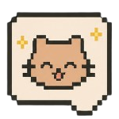

<br><br>

[](https://github.com/meyyy-G/pet-desktop)
[](https://www.python.org/)
[](https://doc.qt.io/qtforpython-6/)
[](LICENSE)
[](https://github.com/meyyy-G/pet-desktop)

<br>

**[⬇️ 下载应用](https://github.com/meyyy-G/pet-desktop/releases)** · **[✨ 功能介绍](#-核心功能)** · **[🖥️ 界面预览](#️-界面预览)** · **[🚀 开始使用](#-下载与安装)**

<br>

> 🚧 项目仍在持续开发中，部分功能尚未完成。欢迎关注后续更新。

</div>

---

## 🌷 关于 PetDesktop

**PetDesktop** 是一款面向 Windows 的桌面陪伴应用，希望将虚拟宠物、生活记录与日常管理自然地结合在一起，打造一个轻松、温暖且个性化的数字生活空间。

在这里，一只可爱的像素小猫会生活在你的电脑桌面上。

你可以抚摸它、喂食、陪它玩耍，观察它在不同状态下的反应。它会随着时间和互动改变行为，在你工作、学习或休息时安静地陪伴你。

双击小猫，还可以打开属于自己的生活空间。

你可以记录日记、整理待办事项、查看日历，以及回顾每天的心情。

而 PetDesktop 的长期目标，不只是提供一个可爱的桌面宠物。

未来，它还将结合 AI 对话能力，让你能够随时分享生活中的想法、心情和故事，并将值得收藏的聊天内容保存到日记与日历中。

**希望 PetDesktop 不只是一个工具，而是一个能陪伴你、帮助你记录生活的桌面伙伴。**

---

## 💭 设计理念

生活不只有待办事项。

还有突然出现的灵感、想要分享的故事、值得纪念的瞬间，以及那些容易被遗忘的小事。

传统的桌面宠物提供陪伴，日记应用帮助记录生活，任务管理工具则负责安排日常。

PetDesktop 希望将这些体验连接起来。

不需要在不同的软件之间频繁切换，也不必将聊天、日记和任务分散在多个地方。

打开电脑，就能看到熟悉的小猫。

想说话的时候，可以和它聊天。

想记录的时候，可以随手写下。

想整理生活的时候，可以打开日历和任务列表。

而过去记录的心情、故事与回忆，也能够随着时间逐渐积累。

**让陪伴、记录与日常管理，成为自然发生的事情。**

---

## 🖥️ 界面预览

PetDesktop 采用原生桌面程序与 Web UI 结合的方式，将桌宠和个人生活空间整合在同一个应用中。

### 🏠 Home · 首页

每天的生活，从这里开始。

Home 页面提供当天日期、问候信息、心情记录、迷你日历和待办事项，让你能够快速了解和整理今天的生活。

主要功能：

* 查看当天日期与问候信息
* 选择并记录每日心情
* 通过迷你日历查看日期
* 添加、编辑、完成或删除待办事项
* 查看部分日常记录摘要

<p align="center">
  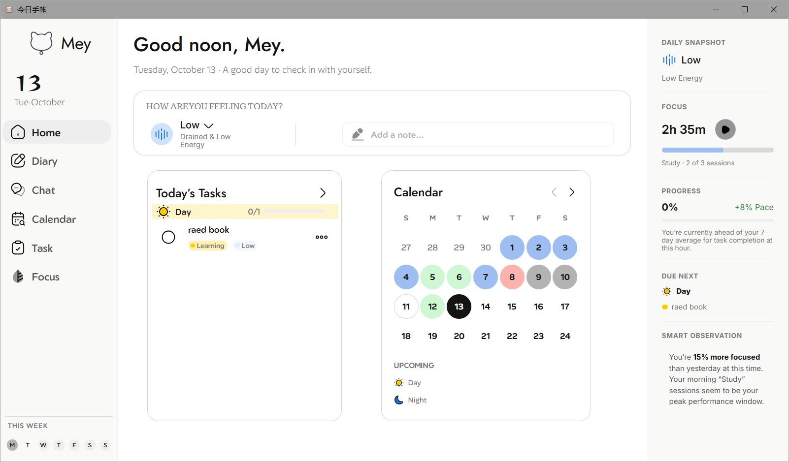
</p>

---

### 📖 Diary · 日记

记录今天发生的事情，留下自己的想法与感受。

Diary 提供按日期管理的日记编辑空间，可以记录日常经历、生活感悟和突然出现的灵感。

主要功能：

* 按日期创建和编辑日记
* 保存并读取历史日记
* 查看当前日记字数
* 使用基础文本标记快捷操作
* 切换日期并查看对应记录
* 在离开未保存内容时显示确认提示

日记数据保存在本地，方便随时查看。

<p align="center">
  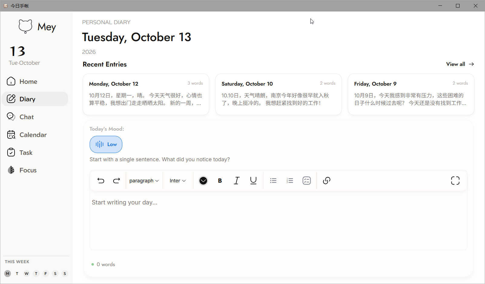
</p>

---

### 🗓️ Calendar · 日历

每一天，都有值得回顾的故事。

Calendar 将日记和心情记录与日期关联，让你能够通过月历查看自己的生活轨迹。

主要功能：

* 按月份浏览日历
* 快速返回今天
* 查看已有日记的日期
* 查看每日心情记录
* 点击日期打开对应日记

随着日记和心情记录不断积累，日历也会逐渐成为属于自己的生活回忆。

<p align="center">
  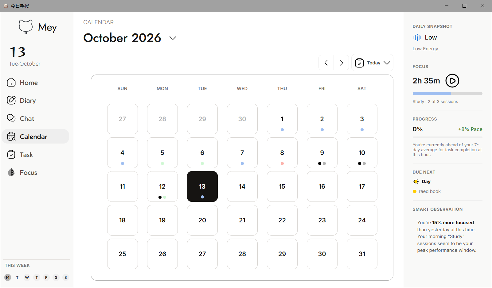
</p>

---

### 💬 Chat · 对话

一个可以随时分享想法的地方。

Chat 是 PetDesktop 未来 AI 陪伴体验的重要组成部分。

希望在未来，你不仅能与桌面小猫互动，也能够通过自然语言对话，分享日常、讨论想法，或者记录突然出现的灵感。

**计划支持的功能：**

* 与 AI 进行自然语言对话
* 保存和查看历史聊天记录
* 收藏有意义的聊天内容
* 将收藏的对话保存到日记
* 通过日历回顾过去的聊天记录
* 逐步建立更加连贯的个人生活记录体验

> **当前状态：** 已有基础 Chat 界面和演示回复，尚未接入真实 AI API。聊天持久化、收藏和跨模块关联功能仍属于后续开发计划。

<p align="center">
  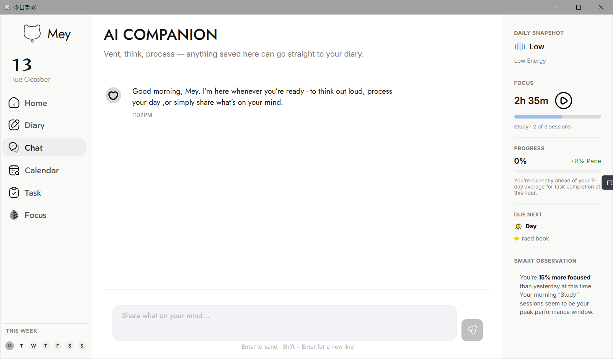
</p>

---

### ✅ Task · 任务管理

把需要完成的事情整理好，让每一天更有条理。

PetDesktop 希望提供轻量、清晰的任务管理体验，在记录生活的同时，也能帮助用户安排日常计划。

**目前已实现：**

* Home 页面添加待办事项
* 编辑任务内容
* 标记任务完成状态
* 删除不再需要的任务
* 在本地保存 Home 任务

**后续计划：**

* 完善独立 Task 页面
* 统一 Home 与 Task 的任务数据
* 提供更加完整的任务组织方式
* 增强任务筛选和查看体验
* 将任务信息与日常统计关联

> **当前状态：** 独立 Task 页面主要用于视觉与布局预览，尚未与 Home 页任务清单实现完整联动。

<p align="center">
  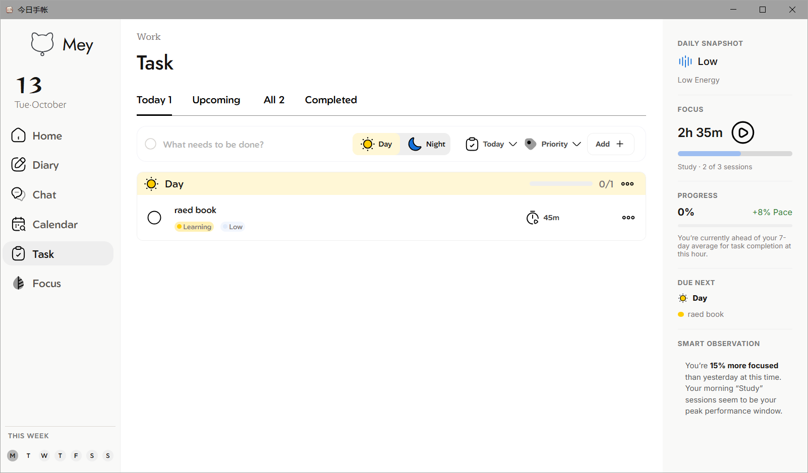
</p>

---

## 🐱 认识你的桌面小猫

PetDesktop 的核心之一，是一只生活在电脑桌面上的像素小猫。

它不只是一个静态的装饰，而是拥有不同动作、需求和情绪反应的虚拟宠物。

你可以和它互动，也可以让它安静地陪伴你工作或学习。

### 🌿 自然行为

小猫会根据空闲时间与当前状态，自动切换不同的日常动作。

当长时间没有互动时，它可能坐下来、打哈欠，或者慢慢躺下休息。

<p align="center">
  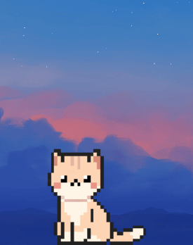
  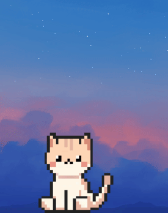
  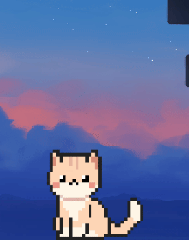
  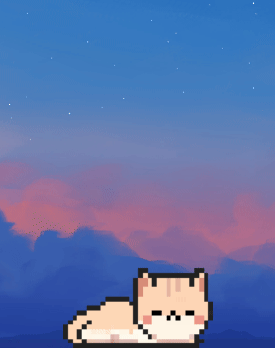
</p>

<p align="center">
  <sub>站立张望 · 坐下 · 打哈欠 · 躺下休息</sub>
</p>

当前自然行为主要由状态机管理。

在没有其他需求或互动动作覆盖的情况下，小猫会随着空闲时间逐渐进入不同的休息状态。

### 🧸 日常互动

你可以通过鼠标与小猫进行互动。

| 操作      | 行为               |
| ------- | ---------------- |
| 单击小猫    | 抚摸小猫，提升心情        |
| 双击小猫    | 打开生活手帐           |
| 拖动小猫    | 移动桌宠位置，触发搬运和落地动画 |
| 右键 → 喂食 | 提升饱食度            |
| 右键 → 玩耍 | 陪小猫玩耍，提升心情       |
| 右键 → 睡觉 | 帮助小猫恢复精力         |
| 右键 → 治疗 | 小猫生病时进行治疗        |
| 右键 → 置顶 | 设置桌宠窗口始终置顶       |
| 右键 → 退出 | 关闭应用             |

<p align="center">
  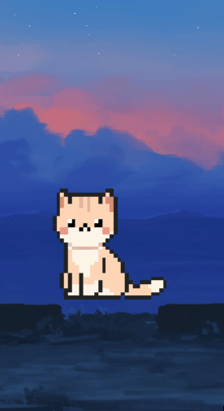
</p>

### 💗 情绪与需求

小猫具有不同的内部状态，包括：

* **饱食度：** 反映小猫的饥饿情况
* **心情值：** 随互动和时间发生变化
* **精力值：** 影响小猫的活动状态

这些状态会在程序运行期间逐渐变化，并影响小猫的动作与反应。

当某些需求降低时，小猫可能表现出饥饿、困倦、难过、生气、哭泣或生病等状态。

<p align="center">
  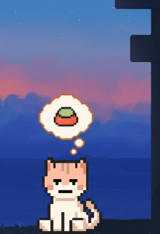
  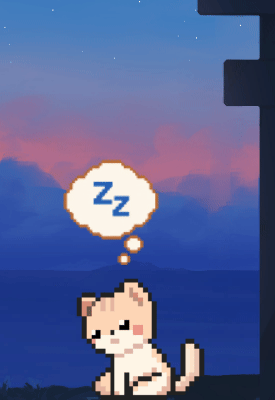
  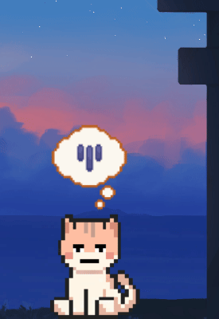
  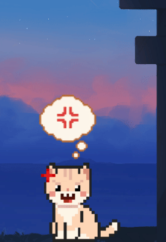
  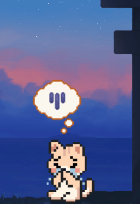
  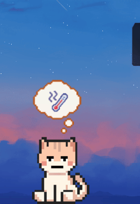
</p>

<p align="center">
  <sub>饥饿 · 困倦 · 难过 · 生气 · 哭泣 · 生病</sub>
</p>

### 💊 生病与治疗

当小猫进入生病状态时，部分普通互动会受到限制。

你可以通过右键菜单选择治疗。

治疗过程中，小猫会展示对应的动画和状态提示。

<p align="center">
  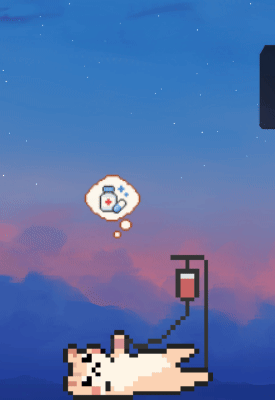
</p>

### ✍️ 陪你写日记

小猫的陪伴并不局限于桌面。

打开手帐后，它也会切换到对应的陪伴姿态。

当你在 Diary 页面输入文字时，小猫还会展示专属的写日记陪伴动画。

<p align="center">
  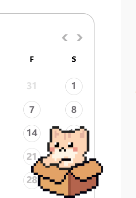
</p>

<p align="center">
  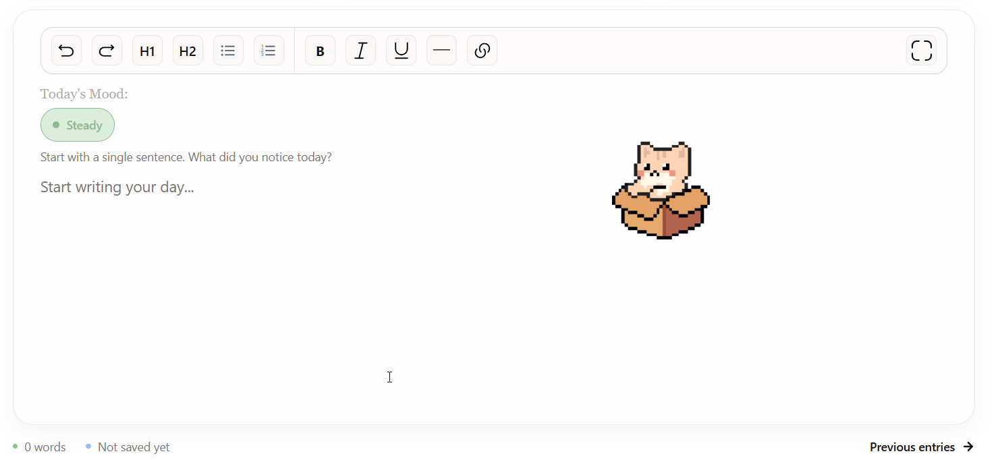
</p>

**即使只是安静地写下一天的故事，也有一个小小的伙伴陪在身边。**

---

## ✨ 核心功能

| 模块               | 功能说明               | 开发状态        |
| ---------------- | ------------------ | ----------- |
| 🐱 Desktop Pet   | 桌面小猫、动画、互动、情绪与需求管理 | ✅ 已实现基础功能   |
| 🏠 Home          | 日期、问候、心情、迷你日历与待办清单 | ✅ 已实现基础功能   |
| 📖 Diary         | 日记编辑、按日期保存、历史记录读取  | ✅ 已实现基础功能   |
| 🗓️ Calendar     | 月历浏览、心情与日记日期关联     | ✅ 已实现基础功能   |
| 💬 Chat          | 对话界面与演示消息          | 🚧 AI 功能待接入 |
| ✅ Task           | 独立任务管理页面           | 🚧 界面预览阶段   |
| ⏱️ Focus         | 专注计时与相关统计          | 📋 规划中      |
| 🔖 Chat Bookmark | 收藏聊天并保存到日记         | 📋 规划中      |

**说明：** 上表根据当前公开仓库中的功能实现情况整理，后续将随开发进度更新。

---

## 🚀 下载与安装

### 下载 Windows 版本

可以通过 GitHub Releases 下载已发布的应用程序。

<p align="center">
  <a href="https://github.com/meyyy-G/pet-desktop/releases">
    
  </a>
</p>

**安装步骤：**

1. 打开 [GitHub Releases](https://github.com/meyyy-G/pet-desktop/releases)。
2. 选择需要下载的版本。
3. 下载对应的 Windows `DesktopPet*.exe` 文件。
4. 双击运行程序。

已打包的单文件程序不需要额外安装 Python。

首次启动时，由于程序需要解包运行资源，可能需要稍长的启动时间。

### 系统支持

| 项目        | 说明              |
| --------- | --------------- |
| 操作系统      | Windows 10 / 11 |
| 系统架构      | 64-bit          |
| 安装方式      | 独立 EXE          |
| Python 环境 | 已打包版本无需安装       |
| 数据保存      | 本地存储            |

目前主要针对 Windows 平台开发，暂未提供 macOS 或 Linux 的正式构建与验证。

> **注意：** Releases 中的版本可能落后于仓库当前源码。下载前建议查看对应版本的更新说明。

---

## 🛠️ 技术架构

PetDesktop 结合了 Python 原生桌面开发与 Web 前端技术。

桌面小猫由 PySide6 提供窗口、动画和交互管理。

手帐与生活管理页面则由 Qt WebEngine 加载 HTML、CSS 和 JavaScript 实现。

两部分通过 QWebChannel 进行通信。

### 技术栈

| 技术           | 用途                     |
| ------------ | ---------------------- |
| Python       | 应用核心逻辑                 |
| PySide6      | 桌面窗口、事件与交互             |
| Qt WebEngine | 加载和展示 Web UI           |
| QWebChannel  | Python 与 JavaScript 通信 |
| HTML         | 页面结构                   |
| CSS          | 页面样式与布局                |
| JavaScript   | 前端交互与页面逻辑              |
| JSON         | 本地日记、心情与桌宠数据           |
| localStorage | Home 任务清单存储            |
| PyInstaller  | Windows 应用打包           |

### 系统组成

PetDesktop 目前主要由两个部分组成。

**1. Desktop Pet · 桌宠系统**

负责：

* 桌宠窗口管理
* 动画状态切换
* 鼠标交互
* 桌宠移动与落地行为
* 情绪与需求值管理
* 桌宠状态保存
* 系统托盘交互

**2. Personal Workspace · 个人生活空间**

负责：

* Home 首页
* Diary 日记
* Calendar 日历
* Chat 对话界面
* Task 任务页面
* 页面交互
* 日记与心情数据读写

### 通信方式

应用使用 QWebChannel 连接 Python 后端与 JavaScript 前端。

```text
                  PetDesktop
                      │
          ┌───────────┴───────────┐
          │                       │
     Desktop Pet             Personal Workspace
          │                       │
       PySide6                Qt WebEngine
          │                       │
    桌宠行为与动画            HTML / CSS / JS
          │                       │
          │                   QWebChannel
          │                       │
          └───────────┬───────────┘
                      │
                Python 数据层
                      │
                本地数据存储
```

这种结构使桌宠逻辑与页面交互能够相对独立地开发，同时保持必要的通信与数据共享。

---

## 📁 项目结构

```text
pet-desktop/
│
├── assets/                      # 图片与运行资源
│   ├── animations/              # 桌宠动画资源（未公开）
│   ├── images/                  # 应用图标与 README 预览图
│   └── web/                     # Web UI 视觉资源（未公开）
│       ├── font/
│       └── svg/
│
├── src/
│   ├── desktop_pet_app.py       # 程序入口
│   │
│   └── desktop_pet/
│       ├── app.py               # 应用初始化与托盘管理
│       ├── paths.py             # 文件与资源路径
│       ├── settings.py          # 应用设置
│       │
│       ├── pet/                 # 桌宠系统
│       │   ├── ...              # 动画、状态与交互模块
│       │
│       ├── diary/               # 手帐窗口与数据通信
│       │   ├── ...              # 日记、心情与 WebChannel
│       │
│       └── web/                 # Web 应用
│           ├── index.html
│           ├── scripts/         # JavaScript 页面模块
│           └── styles/          # 页面样式
│
├── tests/                       # 测试
├── docs/                        # 项目文档
├── tools/                       # 开发辅助工具
│
├── DesktopPet.spec              # PyInstaller 配置
├── build.bat                    # Windows 打包脚本
├── run_app.bat                  # 运行脚本
│
├── requirements.txt             # 运行依赖
├── requirements-dev.txt         # 开发依赖
├── CHANGELOG.md                 # 更新记录
├── LICENSE                      # 开源许可
└── README.md                    # 项目说明
```

---

## 💻 从源码运行

### 环境要求

建议使用：

* Windows 10 / 11
* Python 3.13
* Git
* pip

### 1. 克隆仓库

```powershell
git clone https://github.com/meyyy-G/pet-desktop.git

cd pet-desktop
```

### 2. 创建虚拟环境

```powershell
py -3.13 -m venv .venv
```

### 3. 安装依赖

```powershell
.venv\Scripts\python.exe -m pip install -r requirements.txt
```

### 4. 启动程序

```powershell
.\run_app.bat
```

也可以直接运行：

```powershell
.venv\Scripts\python.exe src\desktop_pet_app.py
```

### 关于资源文件

本仓库公开应用源代码和 README 中使用的预览素材，但不包含完整的原创视觉资源。

未公开资源主要包括：

* 桌宠完整动画帧
* 部分 UI 图片
* SVG 图标资源
* Web 字体
* 其他原创视觉素材

相关文件已通过 `.gitignore` 排除。

因此，**仅克隆公开仓库并安装 Python 依赖，可能无法正常还原完整界面或运行程序。**

以上源码运行步骤主要适用于已经具备完整本地资源的开发环境。

普通用户建议直接下载已发布的 Windows 版本。

---

## 📦 本地打包

PetDesktop 使用 PyInstaller 构建 Windows 可执行程序。

在具备完整私有资源的开发环境中运行：

### 安装开发依赖

```powershell
.venv\Scripts\python.exe -m pip install -r requirements-dev.txt
```

### 执行打包

```powershell
.\build.bat
```

打包完成后，生成的程序位于：

```text
dist/
└── DesktopPet.exe
```

当前采用 PyInstaller 单文件模式。

`build/` 和 `dist/` 均为本地构建目录，不直接提交至 Git 仓库。

面向用户的可执行程序通过 GitHub Releases 发布。

---

## 💾 本地数据与隐私

PetDesktop 当前主要采用本地数据存储方式。

日记、心情、桌宠状态和部分应用设置不会自动上传至云端。

### 数据类型

| 数据      | 存储方式                      |
| ------- | ------------------------- |
| 日记内容    | 本地 JSON                   |
| 每日心情    | 本地 JSON                   |
| 桌宠状态    | 本地数据文件                    |
| 桌宠位置与设置 | 本地设置文件                    |
| Home 任务 | Qt WebEngine localStorage |
| Chat 消息 | 当前未持久化                    |

### 默认数据目录

源码运行时，相关 JSON 数据默认保存在项目的：

```text
data/
```

打包后的 Windows 程序默认使用：

```text
%LOCALAPPDATA%\DesktopPet
```

也可以通过环境变量自定义数据目录：

```text
DESKTOP_PET_DATA_DIR
```

### 隐私说明

当前 Chat 页面尚未接入外部 AI 服务。

未来如果接入第三方 AI API，将进一步说明：

* AI 服务提供方
* 对话数据的传输方式
* 数据保存与删除机制
* 相关隐私设置

用户日记与个人数据不应提交到公开 Git 仓库。

---

## 🗺️ 开发路线

PetDesktop 仍在持续开发中。

以下是项目目前的功能进度与未来规划。

### 🐱 桌宠系统

* [x] 透明无边框桌宠窗口
* [x] 桌宠拖动与落地动画
* [x] 自然待机行为
* [x] 抚摸互动
* [x] 喂食、玩耍和睡觉
* [x] 饱食度、心情与精力管理
* [x] 生病与治疗动画
* [x] 系统托盘入口
* [x] 桌宠位置保存
* [ ] 更多互动动作
* [ ] 更丰富的行为反馈

### 📖 生活记录

* [x] 日记创建与保存
* [x] 根据日期读取日记
* [x] 基础日记编辑功能
* [x] 未保存内容提醒
* [x] 每日心情记录
* [x] 日历查看日记与心情
* [ ] 自动生成真实的历史日记摘要
* [ ] 更完整的日记检索和整理

### 💬 AI 对话

* [x] Chat 基础界面
* [x] 演示消息交互
* [ ] 接入真实 AI 服务
* [ ] 聊天历史持久化
* [ ] 消息收藏
* [ ] 收藏内容保存至日记
* [ ] 对话与日历关联
* [ ] 更自然的桌宠与 AI 交互体验

### ✅ 任务与效率

* [x] Home 基础待办清单
* [x] 添加、编辑与删除任务
* [x] 任务完成状态管理
* [x] 本地任务存储
* [ ] 独立 Task 页面功能完善
* [ ] Home 与 Task 任务同步
* [ ] Focus 专注计时
* [ ] 真实任务与专注统计
* [ ] 更完整的日常管理体验

### ⚙️ 应用体验

* [x] 原生桌面与 Web UI 集成
* [x] 本地数据保存
* [x] Windows EXE 打包
* [ ] 更多个性化设置
* [ ] 进一步优化交互与动画
* [ ] 优化界面适配和性能

> 开发计划可能根据实际需求和项目进度调整。

---

## 🌱 未来愿景

PetDesktop 最初从一只简单的桌面小猫开始。

但我希望，它最终能够成为一个真正融入日常生活的个人空间。

不仅可以陪伴你工作和学习，也能在你想说话的时候倾听，在你想记录的时候帮你留下回忆，在你需要整理生活的时候提供帮助。

未来，我希望 AI 对话、日记、日历与任务之间能够形成自然的联系。

例如，你可以在聊天中分享今天发生的事情，随时收藏有意义的内容，再通过日记或日历重新找到它们。

随着时间积累，PetDesktop 不仅保存任务和文字，也能够帮助你回顾自己生活中的点滴。

**让桌面上的小猫，慢慢成为熟悉你日常生活的数字伙伴。**

---

## 📄 开源许可

本仓库中公开的应用代码采用 [MIT License](LICENSE)。

请注意：

部分原创美术、动画、图标、字体及其他视觉资源并未公开发布，也不随公开代码一同授权。

未经许可，请勿将未公开的视觉素材用于重新分发或商业用途。

---

## 💌 关于项目

PetDesktop 是一个持续开发中的个人独立项目。

它结合了我对桌面宠物、交互设计、日常记录和 AI 应用的兴趣。

从桌宠行为、界面设计到功能实现，我希望通过不断尝试与迭代，让它逐渐成长为一个真正实用、自然且有温度的桌面应用。

项目仍有许多需要完善的地方，也会持续记录开发进展。

感谢每一位关注 PetDesktop 的人。

<br>

---

<div align="center">


### 🐾 PetDesktop

**记录生活，整理日常，让陪伴自然发生。**

*A little companion for your everyday life.*

<br>

[⬆️ 返回顶部](#-petdesktop)

</div>
