

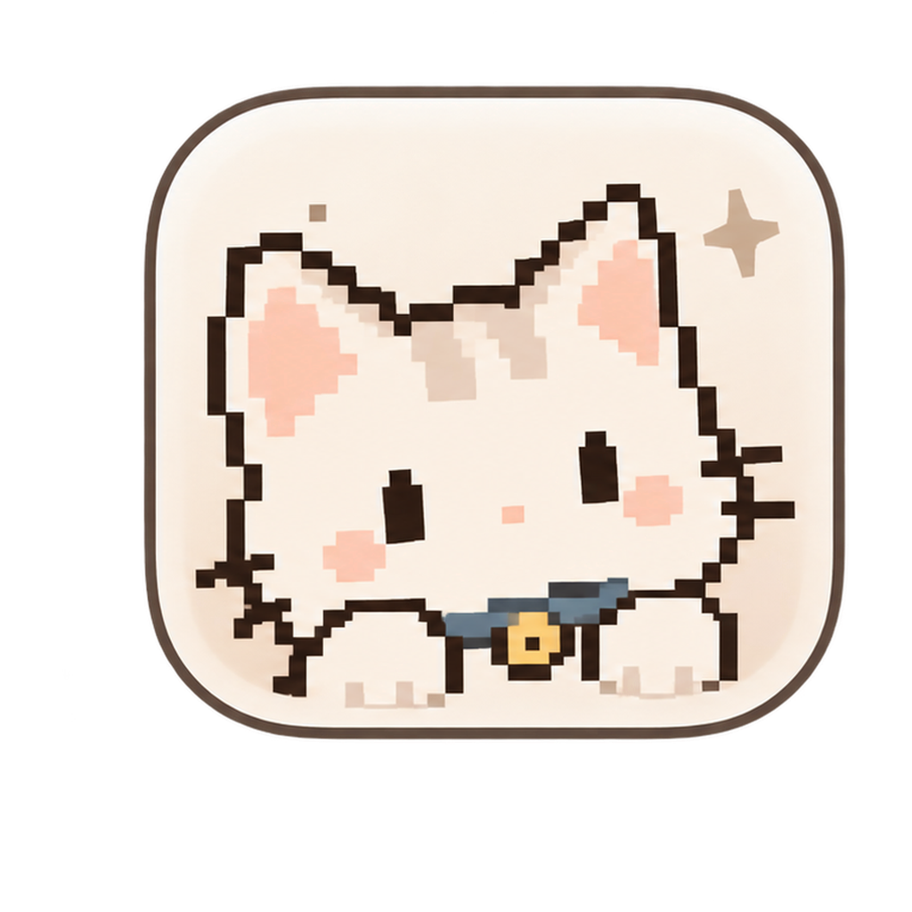

# 🐾 PetDesktop

### 让生活中的每一个瞬间，都有一只小猫陪伴。

一款将桌面宠物、日记、心情记录、日历与任务管理结合在一起的 Windows 桌面应用。

[下载 Windows 版本](https://github.com/meyyy-G/pet-desktop/releases) · [查看更新日志](CHANGELOG.md) · [反馈问题](https://github.com/meyyy-G/pet-desktop/issues)

---

## 关于项目

PetDesktop 希望把桌面陪伴与日常记录放进同一个轻量空间里：小猫会停留在桌面上，根据互动、需求和空闲时间呈现不同状态；双击小猫即可打开手帐，在 Home、Diary、Calendar、Task 和 Chat 页面中记录生活。

当前项目由两部分组成：

- **桌面宠物**：透明置顶窗口、动画状态、拖拽物理、需求数值与互动反馈。
- **生活手帐**：由 PySide6、Qt WebEngine 和 QWebChannel 驱动的 Web UI，数据保存在本机。

> 当前版本仍在持续开发。README 中的“已实现”均以仓库现有代码为准；未完成的功能会明确标注。

---

## 界面预览

### Home · 今日概览

  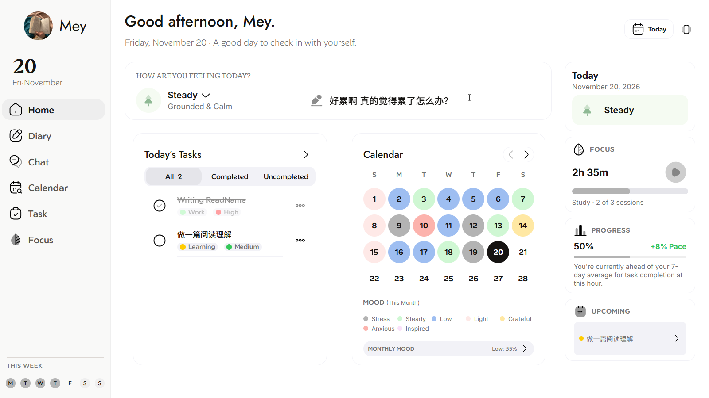

- 今日心情与心情备注
- 今日任务、完成进度与即将到来的任务
- 月历与当月心情概览
- 页面右侧的 Today、Progress、Upcoming 摘要
- Home 与 Task 共用同一份本地任务数据

### Diary · 日记

  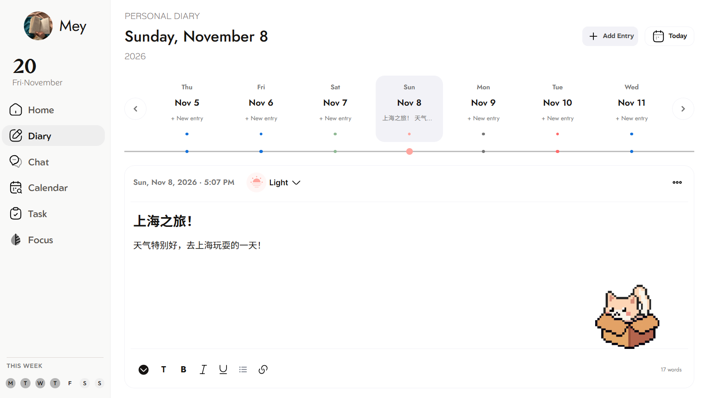

- 按日期读取、创建、编辑和删除日记
- 富文本编辑：标题、列表、引用、文字样式、对齐与颜色
- 支持插入 PNG、JPG/JPEG、WebP 图片
- 编辑后自动保存，并根据真实保存结果显示状态
- 周时间轴、Today 跳转、历史日记阅读
- 显示当天从 Chat 收藏的内容
- 可收起时间轴，获得更专注的写作区域

### Calendar · 日历

  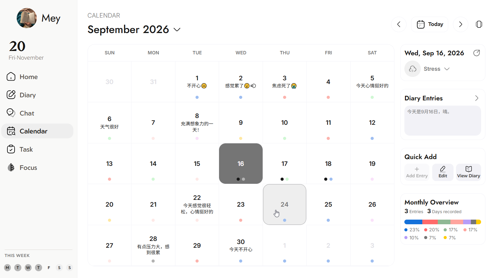

- 月视图与月份切换
- 按日期显示心情和日记记录
- 查看选中日期的心情、备注与日记摘要
- 快速添加、编辑或打开对应日记
- 月度记录天数与心情分布统计
- 独立的历史日记详情视图

### Task · 任务管理

  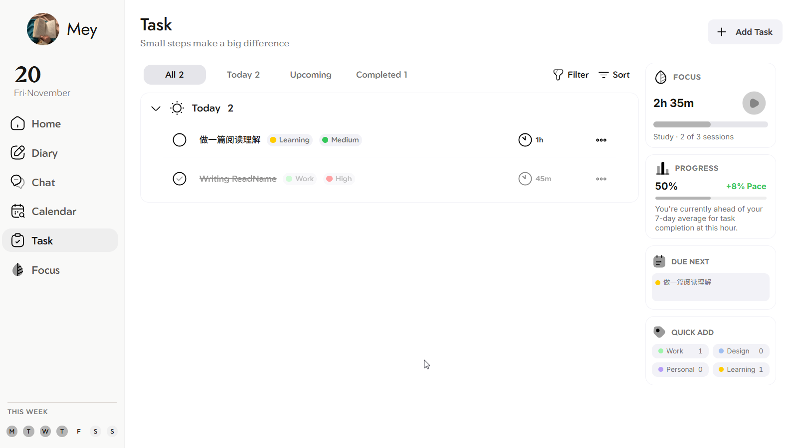

- 新增、编辑、完成、重新打开和删除任务
- All、Today、Upcoming、Completed 四种视图
- Work、Design、Personal、Learning 标签
- Low、Medium、High 优先级与专注时长
- 按标签、优先级和完成状态筛选
- 按时间或优先级排序
- Home 与 Task 页面实时读取同一份 Python 本地数据

### Chat · 本地对话记录

  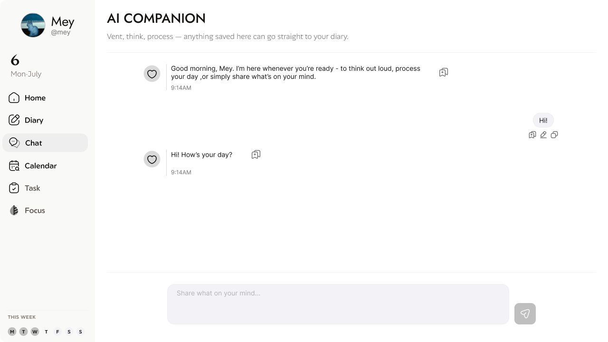

- 对话消息保存在本机
- 用户消息支持编辑与复制
- 用户或助手消息可以收藏到当天日记
- Diary 页面会按日期展示收藏内容

> **AI 尚未接入。** 当前 Chat 已完成界面、本地消息存储与日记收藏流程，但发送消息不会调用任何在线 AI API。后续可在现有 reply provider 边界接入模型服务。

### Focus · 规划中

导航栏中的 Focus 页面目前处于禁用状态；Home 中的 Focus 卡片仅提供界面交互预览，还不是完整的计时与统计系统。

---

## 桌面小猫

### 自然行为

  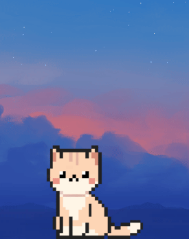
  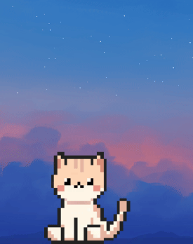
  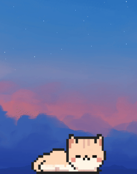
  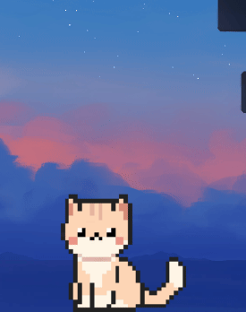

小猫拥有独立的自然行为状态机。随着无互动时间增加，会在 Looking、Sitting、Gaping、Laydown 等状态之间切换；用户再次互动后，会自然恢复到合适状态。

### 拖拽与日常互动

  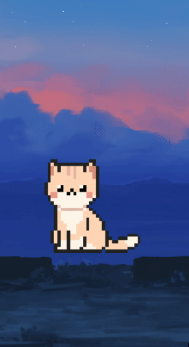

- 单击或抚摸小猫会触发互动动画
- 拖动小猫时显示携带状态，释放后产生下落与落地效果
- 双击小猫打开手帐
- 右键菜单提供喂食、玩耍、睡觉、治疗、置顶和退出等操作
- 系统托盘可打开手帐或彻底退出应用

### 需求与照顾

  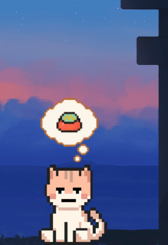
  
  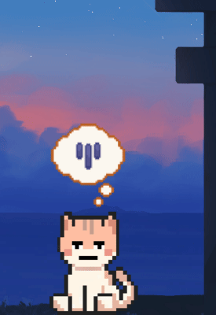
  
  

饱食度、心情值和精力值会随时间变化，并保存在本机。小猫会根据最需要关注的状态显示对应动画和提示，互动也会受到当前数值约束。

### 生病与治疗

  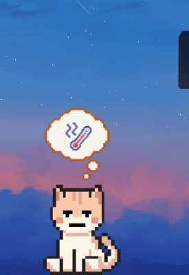
  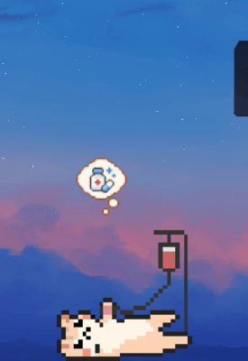

需求状态持续过低时，小猫可能进入生病状态。治疗期间会锁定相应照顾流程，完成后恢复正常行为。

### 陪你写日记

  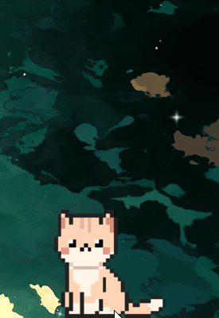
  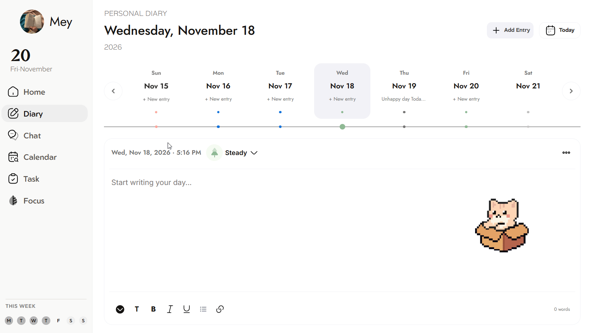

打开手帐或在 Diary 中输入内容时，小猫会切换到相应陪伴动画；离开页面后回到当前应有的桌宠状态。

---

## 功能状态

| 模块 | 当前状态 |
| --- | --- |
| 桌面宠物、拖拽与状态动画 | 已实现 |
| 饱食度、心情值、精力值与本地持久化 | 已实现 |
| Home 今日概览与心情记录 | 已实现 |
| Diary 富文本、插图、自动保存与历史记录 | 已实现 |
| Calendar 日记/心情联动与月度概览 | 已实现 |
| Task 增删改查、筛选、排序与本地持久化 | 已实现 |
| Chat 本地消息与收藏到日记 | 已实现 |
| 在线 AI 回复 | 未接入 |
| Profile 昵称与本地头像 | 已实现 |
| Focus 计时与统计 | 规划中 |
| 账户、登录与云同步 | 规划中 |

---

## 下载与使用

### 下载 Windows 版本

普通用户建议直接前往 [GitHub Releases](https://github.com/meyyy-G/pet-desktop/releases) 下载最新版 Windows EXE。

1. 打开 Releases 页面。
2. 选择最新版本。
3. 在 Assets 中下载 DesktopPet 开头的 Windows EXE。
4. 双击运行；若 Windows 显示未知发布者提示，请确认下载来源后再继续。

| 项目 | 支持情况 |
| --- | --- |
| 操作系统 | Windows 10 / 11 |
| 架构 | x64 |
| macOS / Linux | 暂无正式构建与验证 |

> Release 版本可能落后于仓库源码，请同时查看对应版本的 Release Notes 与 [CHANGELOG.md](CHANGELOG.md)。

---

## 从源码运行

### 环境要求

- Windows 10 / 11
- Python 3.10 或更高版本
- Git

### 1. 克隆仓库

~~~powershell
git clone https://github.com/meyyy-G/pet-desktop.git
cd pet-desktop
~~~

### 2. 创建虚拟环境并安装依赖

~~~powershell
python -m venv .venv
.venv\Scripts\python.exe -m pip install -r requirements.txt
~~~

### 3. 启动

~~~powershell
run_app.bat
~~~

也可以直接运行：

~~~powershell
.venv\Scripts\python.exe src\desktop_pet_app.py
~~~

### 关于私有视觉素材

仓库公开了程序代码与 README 展示图片，但**没有公开完整桌宠动画、Web UI 原始素材和其他美术资源**。因此，仅克隆公开仓库可能无法获得与 Release 完全相同的视觉效果，也可能无法直接完成完整构建。

- 想体验完整版本：请下载 GitHub Release。
- 想阅读或参与代码开发：可以克隆源码。
- 展示图片不代表其原始素材已开放授权。

---

## 本地打包

安装开发依赖：

~~~powershell
.venv\Scripts\python.exe -m pip install -r requirements-dev.txt
~~~

执行打包：

~~~powershell
build.bat
~~~

构建配置位于 DesktopPet.spec。当前配置生成单文件、无控制台的 Windows 应用，并只收集程序实际需要的 Qt/WebEngine 组件与资源：

~~~text
dist/
└── DesktopPet.exe
~~~

完整打包需要本地存在未公开的 assets/animations、assets/web、assets/images/icons 和 Web UI 资源。

---

## 技术架构

| 技术 | 用途 |
| --- | --- |
| Python | 应用逻辑、数据存储与桌宠状态 |
| PySide6 / Qt Widgets | 桌面窗口、托盘、菜单与文件选择 |
| Qt WebEngine | 承载手帐 Web UI |
| QWebChannel | JavaScript 与 Python 双向通信 |
| HTML / CSS / JavaScript | Home、Diary、Chat、Calendar、Task 与 Profile |
| JSON | 日记、心情、任务、聊天和设置的本地持久化 |
| Pillow | 图像资源处理支持 |
| PyInstaller | Windows EXE 打包 |

核心数据流：

~~~text
Web UI
  │  JavaScript
  ▼
QWebChannel / DiaryBridge
  │
  ├── DiaryStore
  ├── MoodStore
  ├── TaskStore
  ├── SavedChatStore
  └── SettingsStore
       │
       ▼
本机 JSON 数据目录
~~~

桌面宠物使用独立的 PetWindow、PetAnimation、PetBehaviorStateMachine、PetStateDecay 与 PetStateStore，并通过信号与手帐窗口联动。

---

## 项目结构

~~~text
pet-desktop/
├── src/
│   ├── desktop_pet_app.py          # 源码启动入口
│   └── desktop_pet/
│       ├── app.py                  # QApplication、托盘与主启动流程
│       ├── paths.py                # 资源和本地数据路径
│       ├── settings.py             # 应用与 Profile 设置
│       ├── data_migration.py       # 旧数据目录迁移
│       ├── pet/
│       │   ├── pet_window.py       # 桌宠窗口与交互
│       │   ├── animation.py        # 动画加载与播放
│       │   ├── behavior_state_machine.py
│       │   ├── pet_state.py
│       │   ├── pet_state_store.py
│       │   └── state_decay.py
│       ├── diary/
│       │   ├── diary_window.py     # Qt WebEngine 手帐窗口
│       │   ├── diary_bridge.py     # QWebChannel 接口
│       │   ├── diary_store.py
│       │   ├── mood_store.py
│       │   ├── task_store.py
│       │   └── saved_chat_store.py
│       └── web/
│           ├── index.html
│           ├── scripts/
│           └── styles/
├── assets/
│   ├── animations/                 # 私有桌宠动画，不进入公开仓库
│   ├── web/                        # 私有 UI 图片，不进入公开仓库
│   └── images/                     # README 展示媒体与本地应用图标
├── tests/
├── docs/
├── DesktopPet.spec
├── build.bat
├── run_app.bat
├── requirements.txt
├── requirements-dev.txt
├── CHANGELOG.md
├── LICENSE
└── README.md
~~~

---

## 本地数据与隐私

PetDesktop 的日记、心情、任务、聊天、桌宠状态与 Profile 信息默认只保存在当前电脑，不会自动上传到 GitHub，也不会发送到云端。

| 数据 | 文件或目录 |
| --- | --- |
| 应用设置与 Profile | config/settings.json |
| Profile 头像副本 | config/avatars/ |
| 桌宠状态 | pet/state.json |
| 日记与插入图片 | journal/ |
| 任务 | tasks/tasks.json |
| 聊天消息与日记收藏 | chat/chat.json |

数据根目录：

- **源码运行**：项目根目录下的 data/
- **打包运行**：%LOCALAPPDATA%\DesktopPet\
- **开发/测试覆盖**：可通过 DESKTOP_PET_DATA_DIR 环境变量指定

升级后的程序会尝试迁移旧版平铺数据结构。重要内容仍建议定期备份整个数据目录。

---

## 测试

项目包含 Python 数据层测试、Node.js 页面逻辑测试，以及需要 Qt WebEngine 的界面 smoke tests。

常用命令：

~~~powershell
.venv\Scripts\python.exe -m pytest
node --test tests\*.test.cjs
~~~

部分界面测试依赖本机 Qt 环境与未公开资源；公开源码环境中请按实际可用资源选择测试范围。

---

## Roadmap

- [x] 桌宠状态机与自然行为
- [x] 拖拽、互动、需求与治疗流程
- [x] Home、Diary、Calendar、Task 页面
- [x] Diary 富文本、插图与自动保存
- [x] Chat 本地消息与收藏到日记
- [x] Profile 昵称与头像
- [x] Windows 单文件 EXE 打包
- [ ] 接入可配置的 AI provider
- [ ] 完整 Focus 计时与统计
- [ ] Settings 页面
- [ ] 数据导出、导入与备份
- [ ] 账户与可选云同步
- [ ] 更多桌宠动画与互动

---

## License 与素材说明

程序代码使用 [MIT License](LICENSE)。

README 中的截图、GIF、桌宠动画、角色形象、图标及其他视觉素材不因代码采用 MIT License 而自动获得相同授权。除非另有明确说明，这些素材仅用于项目展示，不授权复制、修改、再分发或商业使用。

---

### 🐾 PetDesktop

愿每一次记录、每一个任务和每一段安静的时间，都有一只小猫陪在身边。

